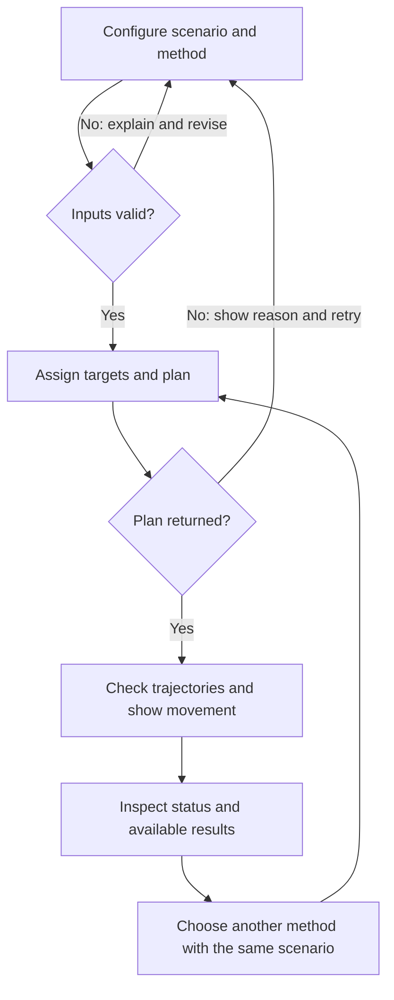
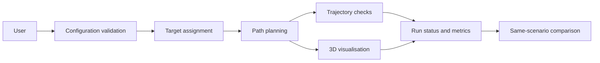

# Investigation of Optimal Path Planning and Formation Changes in Drone Swarms

[Project outline](01-project-outline.md) · [Presentation 1](03-presentation-1.md)

**Status:** Initial functional specification for Semester 1 — Presentation 1, by Tao Fuyuan (GF9EDC), for discussion with Professor Oláh Gábor. All requirements, priorities, boundaries, and technical directions below are proposed. No supervisor approval, implemented algorithms, or experimental results are claimed. The original project brief and accepted application are missing.

## Problem and proposed MVP scope

The current interpretation is formation-change planning in a drone swarm: assign each drone to a target position, then plan coordinated movement that respects minimum separation, speed limits, and acceleration limits. Assignment and trajectory planning are separate concerns; valid inputs or a short assignment do not prove that movement is safe. The optimization objective and constraints need agreement before any claim of optimality.

The proposed Semester-2 MVP is a 3D simulation. Users configure drone count, initial and target formations, motion limits, minimum separation, and a planning method. They view assigned targets and movement, inspect safety checks and run results, and compare methods under identical settings. Comparing at least two strategies is a candidate scope, not a course requirement or an approved decision.

Proposed exclusions: physical drones, real communication, GPS errors, wind, and battery modelling. No hardware control is planned. Semester 1 develops planning documents and an initial technical proposal; Presentation 1 does not require a complete implementation.

## 1. Actors and permissions

| Role | Needs | Responsibility / access |
| --- | --- | --- |
| Student (proposed) | Observe formation changes and understand planning | Configure a scenario, view movement, and inspect results |
| Researcher (proposed) | Compare methods under the same conditions | Run methods on the same scenario and compare results |

The main audience remains to be confirmed. These are usage roles; accounts, authentication, and different access levels are not currently proposed.

## 2. Use cases / user stories

### Configure and run a formation change

- **Actor:** Student or researcher.
- **Precondition:** A supported simulation configuration interface is available.
- **Main flow:**
  1. Choose drone count and initial and target formations.
  2. Set speed and acceleration limits, minimum separation, and a planning method.
  3. The system validates the configuration and reports any invalid fields.
  4. The system assigns one distinct target to each drone and plans movement.
  5. The system checks trajectories and shows the movement in 3D.
  6. The actor inspects the run status, constraint checks, and available metrics.
- **Alternative / error flows:** Invalid settings prevent planning and identify the fields to fix. If planning fails, explain the reported reason and allow revision and retry. If checking finds a separation or motion-limit violation, flag the run as unsuccessful; do not present it as safe. If verification is incomplete, label safety as unverified. Missing measurements are marked unavailable rather than replaced with zero.
- **Postcondition:** The user sees a clearly labelled outcome and the settings used. A successful result requires target completion and constraint verification, subject to agreed definitions.

### Compare methods on the same scenario

- **Actor:** Researcher or interested student.
- **Precondition:** A scenario is configured and at least two candidate methods are available; inclusion remains to be confirmed.
- **Main flow:**
  1. Run one method and inspect its results.
  2. Keep the drone count, formations, limits, separation, and any scenario seed unchanged.
  3. Select another method and run again.
  4. Compare run status, completion time, total path length, planning time, and minimum separation using the same definitions.
- **Alternative / error flows:** Failed runs remain visible as failures. Partial measurements are labelled. Changed scenario settings invalidate the same-scenario comparison and require rerunning the methods.
- **Postcondition:** Results are associated with their methods and a shared scenario, without implying an optimal method.

## 3. Functional requirements

The following priorities and acceptance criteria are candidates for the later implementation.

| ID | Requirement | Candidate acceptance criteria | Priority |
| --- | --- | --- | --- |
| FR1 | Configure a scenario | Given supported formations, the user can set drone count, initial and target formations, speed and acceleration limits, safe separation, and a method; the displayed configuration retains those values. | Must |
| FR2 | Validate configuration | Invalid counts, non-finite values, invalid limits, missing positions, or mismatched formation sizes prevent planning and show a reason; corrected inputs can be retried. Supported ranges remain to be agreed. | Must |
| FR3 | Assign targets | For an accepted configuration with matching formation sizes, each drone receives one target and no target is assigned twice; failure is reported. | Must |
| FR4 | Plan and show movement | A returned plan can be viewed in 3D from initial to assigned target positions. Planning failure displays a reason and allows configuration changes. | Must |
| FR5 | Check trajectory constraints | Check pairwise separation, speed, and acceleration over the planned movement using an agreed verification method. Report violations and never label an unchecked or violating trajectory as verified safe. | Must |
| FR6 | Show outcome and measurements | Show success, failure, or unverified outcome and candidate metrics: completion time, total path length, planning computation time, and minimum separation. Missing metrics are explicitly unavailable. | Must |
| FR7 | Compare methods | For unchanged scenario settings, associate each method with its outcome and measurements. If settings change, require fresh runs before claiming a same-scenario comparison. | Should |

**Must** = proposed MVP requirement; **Should** = important candidate; **Could** = optional. These priorities require supervisor discussion. No numeric performance thresholds have been selected.

## 4. Business rules and constraints

| Rule or constraint | Rationale |
| --- | --- |
| Drone count is a positive integer; each formation has that many finite 3D positions. | Target assignment requires consistent inputs. |
| Motion limits and minimum separation must be finite and positive in the proposed configuration model. | Invalid settings cannot define a meaningful run; supported ranges are to be confirmed. |
| Check initial and target separation as part of input validation. | Invalid endpoints should be reported early, but safe endpoints alone do not prove safe movement. |
| Each drone is assigned exactly one unique target. | Defines completion of the formation change. |
| Check separation and motion constraints throughout movement. | A visually convincing animation is not evidence of a safe trajectory. |
| A completed run is successful only when all drones reach assigned targets and checks pass. | Completion tolerance and verification coverage must first be agreed. |
| If checks only sample time steps, state the coverage and limitations. | Samples can miss a violation between frames; a continuous-safety claim needs adequate verification. |
| Compare methods using the same scenario and metric definitions. | Prevents misleading comparisons; random seeds, if used, must be recorded. |
| “Optimal” requires an explicit objective and constraints plus evidence. | The formal project title does not prove a method is optimal. |

Invalid configuration, planning failure, infeasibility, constraint violations, and incomplete checks must be distinguished in the result. Failure to find a plan must not automatically be presented as proof that no feasible plan exists.

## 5. User interface and workflow

Proposed main views: scenario setup, 3D simulation, and run results / comparison. Setup contains the configuration fields. The simulation view shows drone positions and run status. Results show the selected method, scenario settings, constraint checks, and available metrics. Errors explain what happened and offer a route back to settings. Detailed wireframes and controls are not yet designed.

Initial journey: choose drone count and formations → set motion limits and safe separation → select a method → validate and run → watch movement → inspect status and results → run another method under the same settings and compare. On invalid input or planning failure, show a reason, edit settings, and retry.

## 6. Non-functional requirements

| Proposed requirement | Candidate verification |
| --- | --- |
| Inputs, units, failures, and unverified results are understandable. | Walk through the main and error journeys with a representative student or researcher; confirm they can explain the result. |
| Runs can be compared reproducibly. | Retain scenario settings, method configuration, and seeds if used; repeat a run and document variation. Persistence mechanism remains open. |
| Safety reporting states its verification coverage. | Review cases with known constraint violations, including between-frame violations, against the selected checking method. |
| Measurements have explicit definitions and units. | Check reported metrics against a simple scenario with independently calculated values; distinguish simulation completion time from wall-clock planning time. |
| Planning and viewing remain usable on agreed representative scenarios. | Measure on a documented machine and scenarios; choose supported scale and limits after consultation and feasibility work. |

No latency, scale, or performance targets have been approved.

## 7. Open questions and risks

| Question / risk | Impact | Owner | Resolution / decision |
| --- | --- | --- | --- |
| Is assignment plus safe formation-change planning the core problem? | Determines research focus | Author, discuss with supervisor | To be confirmed against the real brief. |
| Are students or researchers the main users? | Determines interface and evaluation | Author, discuss with supervisor | To be confirmed. |
| Is a 3D MVP with two strategies feasible? | Affects implementation scope | Author, discuss with supervisor | Candidate scope only. |
| Which formations and test scenarios should be supported? | Determines input model and comparisons | Author, discuss with supervisor | Select representative scenarios; no list approved. |
| Which objective and constraints define optimization? | Determines fair evaluation | Author, discuss with supervisor | Candidate metrics documented; objective and tolerances open. |
| How will continuous separation and motion limits be verified? | Affects trust in safety claims | Author | Evaluate verification approaches; do not infer safety from sampled animation alone. |
| Are the proposed exclusions and journeys suitable? | Affects boundaries and workflow | Author, discuss with supervisor | To be confirmed. |
| Original brief and accepted application are missing. | Cannot verify assignment provenance or scope alignment | Author | Obtain originals; preserve accepted application at `00-application.md`. |
| GitHub Projects board URL is unavailable. | Course workflow setup remains unverified | Author | Supply or verify the real board; do not invent a URL. |
| Referenced `evaluation-1-en` is unavailable. | Full assessment rubric cannot be checked | Author | Obtain it; supplied requirements still guide this draft. |

Supervisor feedback: none supplied or recorded yet. Record actual feedback after the consultation.

## 8. Initial technical specification proposal

### Proposed solution

Candidate direction: a configurable 3D simulator with separate configuration validation, target assignment, path planning, trajectory checking, visualisation, and result comparison. This is a planning sketch, not an implemented or approved architecture. Detailed design will follow confirmation of the functional scope.

### Technology direction

| Area | Candidate technology / approach | Reason for consideration | Open question / risk |
| --- | --- | --- | --- |
| Simulation and interface | A 3D engine or application framework, not yet selected | Show and inspect formation changes | Confirm platform, development effort, and supported drone count. |
| Target assignment | Compare distance-based assignment approaches | Relates drones to target positions | A distance objective alone may not yield safe coordinated movement. |
| Path planning | Baseline movement strategy and a constraint-aware candidate | Study movement under shared constraints | Algorithms and comparison scope are not yet selected. |
| Safety verification | Trajectory checks independent of rendering | Detect separation and motion-limit violations | Determine adequate coverage between time samples. |
| Results and scenario data | Structured scenario and run records | Keep methods and metrics comparable | Select data format and decide whether export or persistence is needed. |
| Deployment | To be confirmed | Depends on intended users and chosen platform | No hosting or backend decision made. |

### Initial architecture sketch

Proposed component responsibilities only; execution order, interfaces, and integration details remain open.

### Feasibility and technical risks

| Risk / assumption | Validation planned for Semester 2 | Fallback approach |
| --- | --- | --- |
| Assignment and motion planning can be combined within the agreed scope. | Try a small agreed formation-change scenario before extending the scenario set. | Reduce supported formations or strategies after discussing the tradeoff. |
| Constraint checking can cover the chosen trajectory representation. | Use known unsafe cases and assess between-frame behaviour. | Restrict the trajectory model and clearly label remaining verification limits. |
| Fair comparison is possible with shared settings and metric definitions. | Repeat methods on the same scenarios and inspect recorded inputs and measurements. | Begin with a smaller, controlled scenario set. |
| The chosen platform supports clear 3D inspection. | Prototype one formation change after platform selection. | Simplify rendering and interface before widening scope. |

All validation is planned; no prototype or experimental result is claimed. A detailed Semester-2 plan and Presentation 2 content are deferred.
