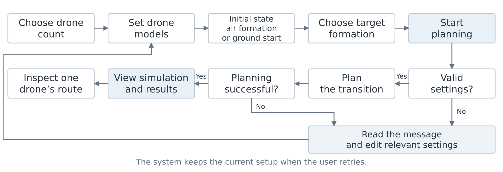
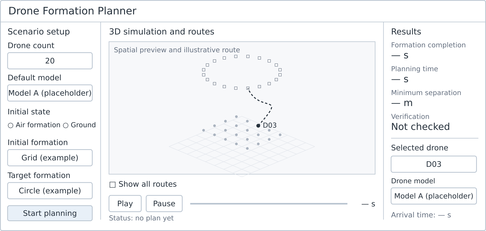
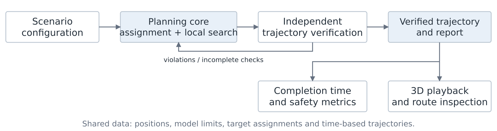
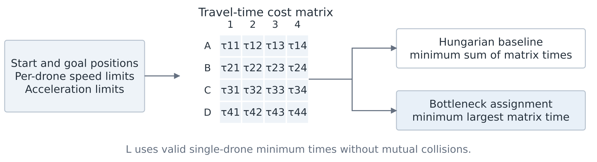
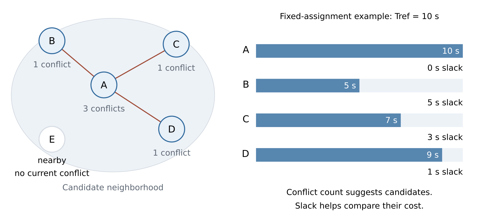
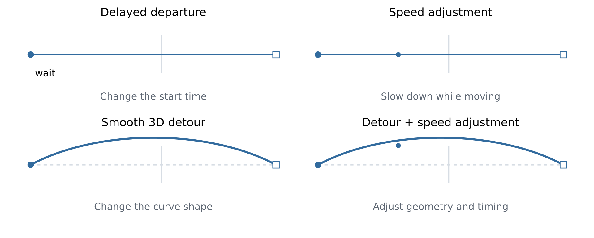
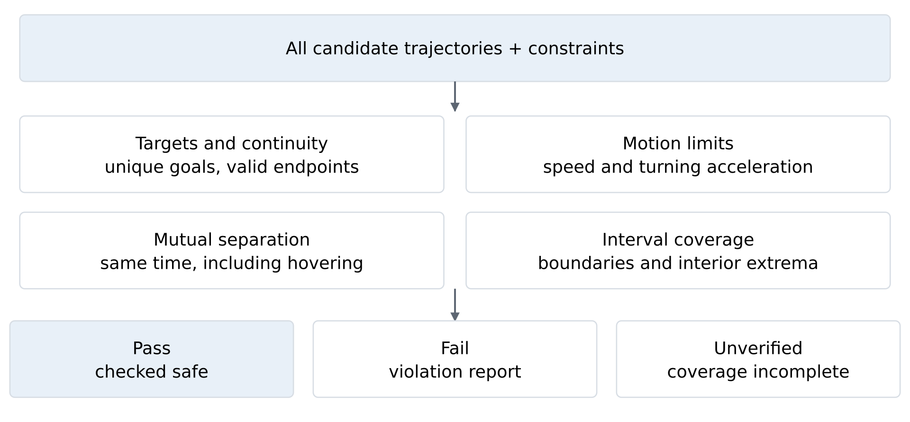
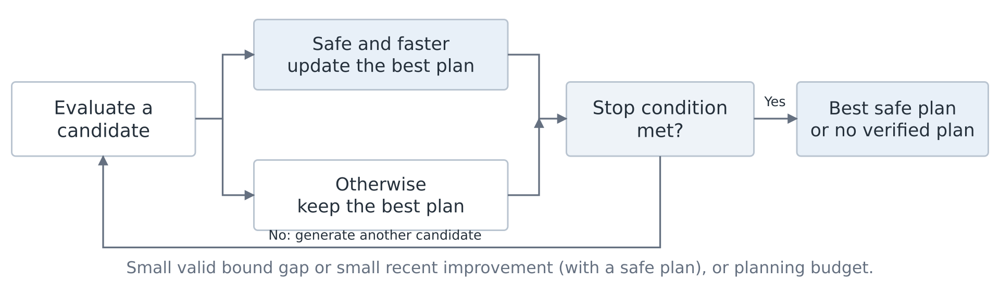

# Investigation of Optimal Path Planning and Formation Changes in Drone Swarms

Presentation 2

Author: Tao Fuyuan  
Neptun: GF9EDC  
Supervisor: Professor Oláh Gábor  
Project ID: 2026-OG-03

---

## Specification summary

- A 3D simulator for planning and inspecting drone formation changes.
- Users: drone show planners and students comparing planning methods.
- Users choose the drone count, drone models, initial state and target formation.
- The main objective is to reduce the time until the last drone arrives, while satisfying motion and separation limits.

---

### Scope and success criteria

- Support an initial airborne formation or a ground-start configuration.
- Plan unique target assignments and coordinated movement using each drone's motion parameters.
- A successful run reaches every assigned target and passes trajectory checks.
- Show completion time, planning time, minimum separation and verification status.
- Physical drones, communication, GPS errors, wind and battery modelling are outside the scope.

---

## Main user journeys and requirements

<!-- @width 90% -->

- Keep the current setup when the user corrects an input or retries planning.
- Selecting a drone changes the route highlight without running the planner again.

---

### Main requirements

| Requirement | Acceptance criterion |
| --- | --- |
| Configure the scenario | The drone count matches the number of initial and target positions. Each drone has a motion profile. |
| Validate inputs | Invalid counts, missing parameters or unsafe endpoints produce a clear message before planning. |
| Plan and verify | Every drone has one unique target. Successful trajectories satisfy the configured limits. |
| Inspect the result | Users can play or pause the simulation and highlight one drone's route. |
| Report the outcome | Show verified success, violations, incomplete checks or no verified plan within the search budget. |

---

### Planned interface

<!-- @width 85% -->

*Static wireframe. Drone models, formations and the route are illustrative placeholders.*

---

## Initial technical proposal

<!-- @width 90% -->

- Separate the planner, trajectory checker and 3D viewer.
- Exchange the same scenario, time-based trajectories and verification report between modules.

---

### Travel time and target assignment

<!-- @width 90% -->

- Calculate single-drone travel times using the chosen speed, acceleration, braking and response-delay model.
- Compare greedy and Hungarian baselines with bottleneck assignment. Compute the lower bound L from valid single-drone minimum-time costs, ignoring mutual collisions.

---

### Conflict count, time slack and local scope

<!-- @width 80% -->

- Count distinct conflicting partners and estimate the cost of changing each drone.
- Use time slack to identify adjustments that may avoid extending the formation completion time.
- Include nearby trajectories in the relevant time window. Recompute conflicts and slack after changes.

---

### Candidate adjustments

<!-- @width 90% -->

- Compare waiting, speed changes, smooth 3D detours and combinations.
- Account for turning acceleration and compare the whole formation's completion time.

Candidate curve and timing methods: [Primitive-Swarm](https://arxiv.org/abs/2502.16887) and [MINCO / GCOPTER](https://arxiv.org/abs/2103.00190).

---

### Trajectory verification

<!-- @width 75% -->

- Check targets, continuity and motion limits. Include drones hovering after arrival in pairwise separation checks.
- For polynomial segments, check boundaries and interior extrema with numerical tolerances. Return the affected drones, time intervals and violated limits. Incomplete checks remain unverified.

---

### Best plan and stopping rules

<!-- @width 90% -->

- Preserve the best verified safe plan. A worse candidate does not replace it.
- With a safe plan, stop when the valid bound gap is small or improvement stays small across a search window. A planning budget also ends the search.
- Return the best safe plan, or report that the search found no verified plan. This does not prove infeasibility.

---

## Semester-2 implementation plan

| Stage | Planned work and checkpoint |
| --- | --- |
| 1. Scenario and motion model | Define formations, ground starts, per-drone parameters and single-drone travel times. Implement assignment baselines. |
| 2. Verification and baseline planner | Check known safe and unsafe cases. Produce a first verified formation change using simple timing adjustments. |
| 3. Local optimization and 3D viewer | Add conflict counts, slack and adjustable neighborhoods. Investigate curve candidates and connect verified trajectories to playback. |
| 4. Experiments and refinement | Compare methods on the same scenarios. Measure completion time, planning time and verification outcomes. Refine the interface and documentation. |

First-person viewing is a later extension after the core planner and viewer.

---

## Open risks and next steps

<!-- @scale 90% -->
| Risk or open choice | Next step |
| --- | --- |
| Model data may omit acceleration or response behaviour | Separate sourced values from explicit simulation assumptions. |
| Curve shape, timing and local scope affect both safety and search cost | Select a curve representation and timing method through small controlled tests. |
| Numerical checks may miss violations | Test between-frame cases and define conservative verification tolerances. |
| Ground layout, supported formations and scale remain open | Define representative scenarios and input limits. Test increasing swarm sizes. |
| Implementation platform and 3D framework remain open | Run a small feasibility test before choosing the stack. |

Next: finalize the motion model, choose a curve method and define comparison cases.
